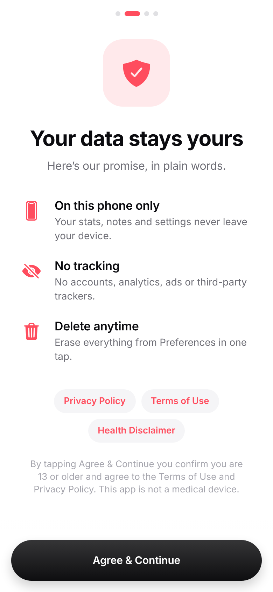
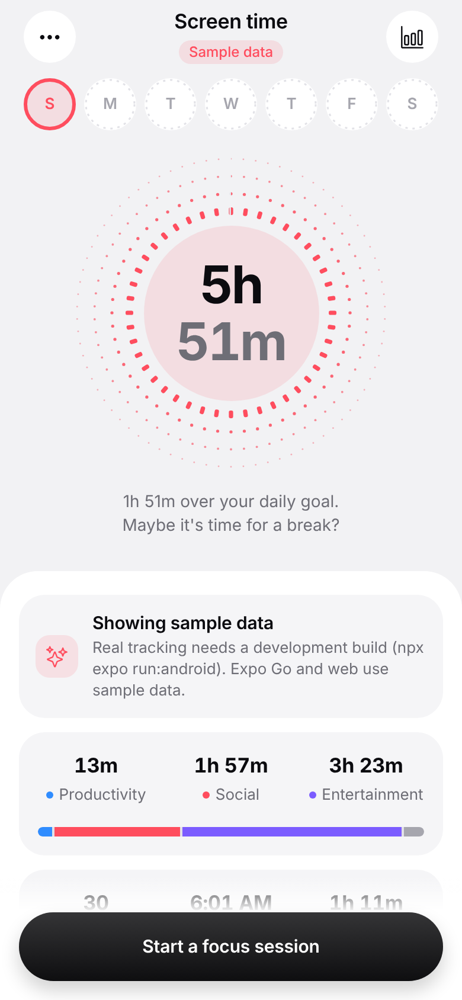
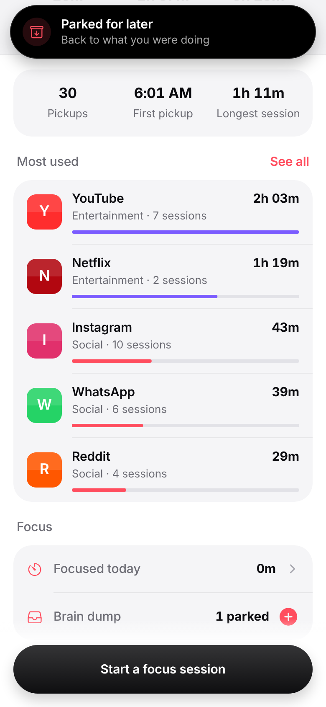
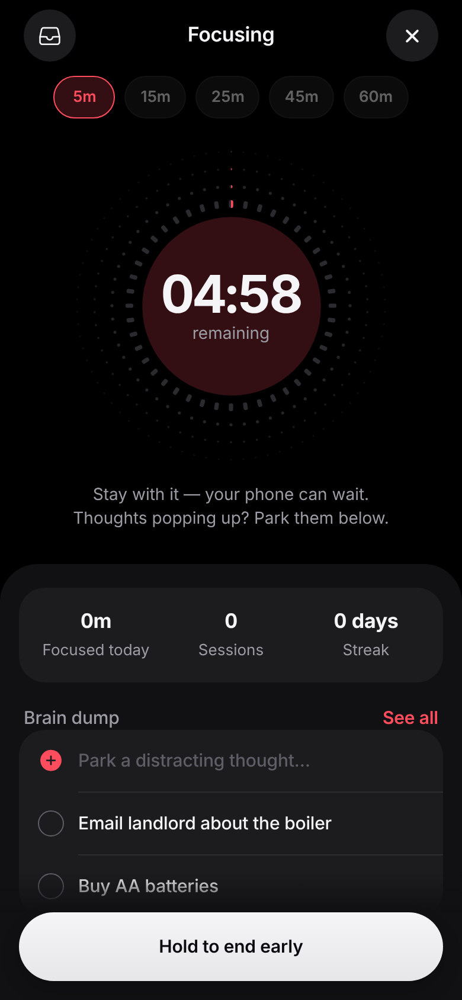
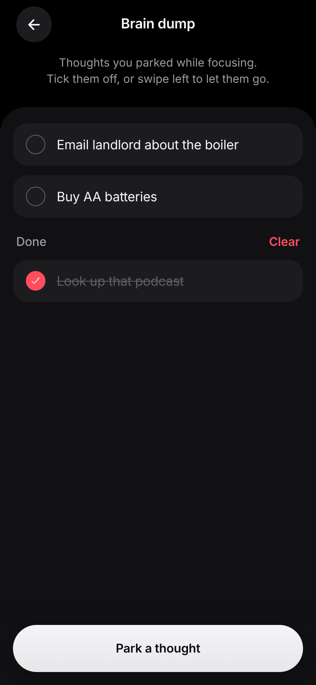
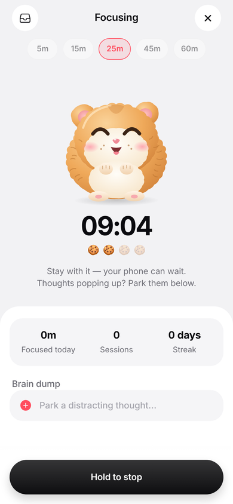
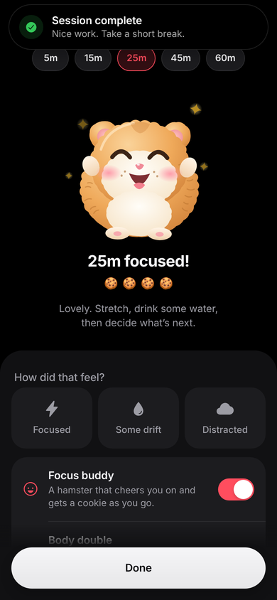

# Screen Time Tracker

A calm, Apple‑style screen‑time tracker built with **React Native + Expo (SDK 58)**. It reads real
per‑app usage on Android, and has room for ADHD‑focused tools later. For now it includes a simple
focus timer.

| Onboarding | Today | Island toast | Focus (dark) | Brain dump (dark) |
| --- | --- | --- | --- | --- |
|  |  |  |  |  |

| Focus buddy | Session complete (dark) |
| --- | --- |
|  |  |

> **Publishing?** Start with [`docs/play-store/README.md`](docs/play-store/README.md). It covers
> placeholders to fill in, hosting the policies, Data safety answers, listing copy, and Play's
> 12‑tester rule.

## Features

The app has three tabs, so everything is one tap away:

- **Today:** your screen time.
- **Focus:** "What do you need right now?" with plain‑language options, each one tap from the
  tool that helps.
- **Insights:** weekly analytics.


- **Today**: a dotted dial that fills toward your daily goal, with rolling digits. Swipe it left or
  right to change day, or tap a week ring. Below it: time per category, pickups, first pickup,
  longest session, your most‑used apps, and a Focus card.
- **Analytics**: daily average with the change from last week, stacked weekly bars with a goal
  line, category averages, a session timeline for each day, an hour‑by‑hour chart, and top apps.
  You can page back through earlier weeks.
- **App detail**: weekly bars, hourly use, sessions, and the app's share of your day.
- **Focus (ADHD‑friendly)**:
  - A visual timer from 5 to 60 minutes. You hold the button to start and hold it to end early.
  - **Time checks** every 5, 10 or 15 minutes, to help with time blindness.
  - **Brain dump**: park a distracting thought in two taps.
  - A short **reflection** after each session.
  - A "session complete" notification, a streak that doesn't break before the day is over, and
    wording that never shames you for stopping.
- **Brain dump list**: tick items off, swipe left to delete, and clear finished ones.
- **Focus buddy**: a live-animated hamster on the focus screen. It breathes, blinks and twitches
  its ears while you work, catches a cookie at every quarter of the session (and chews it), gets
  happier as you go, and hops with its paws up when the timer completes. All layers are static SVGs
  animated only with transform/opacity on the UI thread, so it stays smooth on mid-range Android,
  and it holds still when the system's reduce-motion setting is on. Can be turned off in Focus.
- **Body double**: during focus, the screen stays on with a softly breathing companion,
  encouraging lines, and optional brown or pink noise (generated in‑repo, no licensing issues).
- **Task breakdown**: split a daunting task into tiny steps, each with its own 5–25 min timer.
  Starting a step opens Focus with that step's name and length, and finishing marks it done.
- **Dopamine menu**: your own list of quick, healthy alternatives. "Pick something for me" spins
  through them like a slot reel, with haptic ticks, and offers a timer for the one it lands on.
- **Up next**: set your next thing and get a notification before it (5–30 min heads‑up), plus a
  live countdown on Today.
- **Daily check‑in**: energy, mood and focus rated 1–5. Analytics shows them as a weekly grid and
  compares focus on days you stayed under your goal with days you went over.
- **Hyperfocus check‑in**: a background check about every 15 minutes, sending one gentle nudge
  when a single app has held you past your threshold. It can cover social/entertainment apps only,
  or all apps.
- **Buddy on Today**: the same hamster lives in a card on Today, fed by today's focus sessions (a
  cookie per quarter of a session, four for finishing one). With no cookies yet it looks hopeful,
  never sad, and tapping it opens Focus.
- **Home‑screen widgets**: today's dial and total, and the focus buddy with today's cookies (tap it
  to start focusing). Add them from Preferences or from the launcher.
- **Weekly recap**: a story‑sized card you can share as an image.
- **Onboarding**: welcome, then privacy promise and consent to the Terms, then the Usage access
  *prominent disclosure* that Google Play requires, then notifications.
- **Preferences**:
  - Theme, accent colour, goal, time checks, reminders, time format, week start, font size and
    haptics. Changes preview live and apply on **Save**.
  - **Delete all data**.
  - Privacy Policy, Terms of Use, Health Disclaimer, open‑source licences, and Contact support.

## Performance on Android

- **No continuous or entrance animation on screens.** Content renders immediately; tap feedback is
  a plain pressed style applied by React Native (no animation driver).
- **The Today dial is one static SVG layer.** It used to be two layers with a mask redrawn every
  frame.
- **Skeletons while data loads.** Heavy screens build their charts after the push transition
  finishes (`useDeferredRender`).
- **Launch screen.** After the native splash, an identical in‑app launch screen stays only until
  settings and today's numbers are ready (2 s at most), then fades out.
- **What still animates:** only things that need motion to make sense — dragging sheets and
  swipe rows, the hold‑to‑stop fill, the switch knob, the toast, and the body‑double companion.

## Motion & feel

The motion follows Apple's HIG and the animations.dev craft guidelines (`src/theme/motion.ts`):

- **Springs:** they settle with no overshoot. Small elements, like colour swatches, are the only
  ones that bounce.
- **Press feedback:** a quick, subtle scale (about 0.97) plus a haptic tap.
- **Entrances:** each section rises in once, with a stagger. Nothing grows from `scale(0)`.
- **Performance:** only `transform` and `opacity` animate, so data reveals run on the UI thread.
  This covers the rings, the dial sweep, the bars and the progress lines.
- **Hold‑to‑confirm:** the fill moves at a linear pace while you hold, with haptic ticks that build
  up. If you let go early it snaps back quickly.
- **Bottom sheet:** opens on the iOS sheet curve and follows your finger 1:1 as you drag. You can
  fling it away using the drag's speed. The backdrop fade is tied to the sheet's position.
- **Navigation on Android:** uses the iOS‑style slide (`ios_from_right`) with an edge‑swipe back
  gesture.
- **Reduce Motion:** respected everywhere. Movement is removed but fades remain, and the ambient
  "breathing" of the dial is switched off.
- **Island toast:** a Dynamic Island‑style toast grows out of a pill at the top of the screen and
  can be swiped away.
- **Rolling numbers:** numbers roll digit by digit, like an odometer (`.numericText()`).
- **Switches:** iOS‑style, with a knob that stretches while you hold it.
- **Swipe‑to‑delete:** a haptic tick marks the point of no return.
- **Header:** the bar and hairline fade in only once content scrolls under it.
- **Focus complete:** finishing a session sends a ripple out of the dial.

## Getting started

```bash
npm install
npm run go                # starts Metro for Expo Go — scan the QR with the Expo Go app
```

Expo Go runs the full UI on realistic sample data. The widget and the hyperfocus check need the
installed app, so they're hidden in Expo Go. (Because `expo-dev-client` is installed, plain
`npx expo start` targets development builds; `npm run go` forces Expo Go. If your phone and computer
aren't on the same Wi‑Fi, use `npx expo start --go --tunnel`.)

### Real usage data (Android)

Real tracking uses a local native module, `modules/usage-stats`, built on Android's
`UsageStatsManager`. That module needs a development build, so it won't work in Expo Go:

```bash
npx expo run:android      # or: npx eas-cli build --profile development --platform android
```

On first launch, tap **Allow usage access** and enable the app under *Settings › Usage access*.
The app turns raw foreground events into sessions, so the per‑hour numbers, the timeline and the
session counts are exact. Unlock events are counted as pickups.

### iOS

iOS doesn't let apps read raw screen‑time numbers. Usage is only available through Apple's Screen
Time API (FamilyControls, plus a DeviceActivity report extension), which needs a special Apple
entitlement. Until that's added, iOS uses sample data.

## Project structure

```
src/app/            screens (Expo Router): onboarding, index, analytics, app/[id], focus, notes,
                    tasks/, menu, recap, settings, legal/[doc], licenses
src/widget/         Android home-screen widget (react-native-android-widget)
src/background/     headless work: widget task handler, hyperfocus check (expo-background-task)
index.ts            app entry — registers headless handlers, then Expo Router
src/components/     UI kit: DottedDial, WeekStrip, WeekBars, HourlyWave, SessionTimeline,
                    OptionSheet, HoldButton, PressableScale, ListRow, …
src/data/           types, aggregation (sessions → day summaries), demo + device sources
src/state/          settings, usage cache, focus sessions + brain dump (persisted stores)
src/legal/          your details, Privacy Policy / Terms / Health Disclaimer text, licences
src/theme/          colours, theme hook, motion tokens
modules/usage-stats Android native module (Kotlin, Expo Modules API)
```

## Scripts

```bash
npm run typecheck
npm run lint
npm run legal:docs                # in-app legal text → docs/legal/*.md + *.html for hosting
npm run legal:licenses            # refresh the open-source licences screen
node scripts/generate-assets.mjs  # icon, adaptive icon, splash, notification icon, widget preview, Play graphics
python3 scripts/generate-ambient.py  # brown/pink noise loops for body-double mode
```

## Privacy

- **No internet:** release builds (EAS `production`/`preview` profiles) set `NO_INTERNET=1`, which
  removes the `INTERNET` permission, so the app can't send data anywhere. See `app.config.ts`.

- **No outgoing data:** no backend, accounts, analytics, crash reporting or ads.
- **Usage stats:** read on demand and kept only in memory.
- **What is stored:** preferences, focus history and notes, in app‑private storage.
- **Legal text:** lives in `src/legal/` (`config.ts` holds your details) and is the single source
  for both the in‑app screens and the hosted pages.
