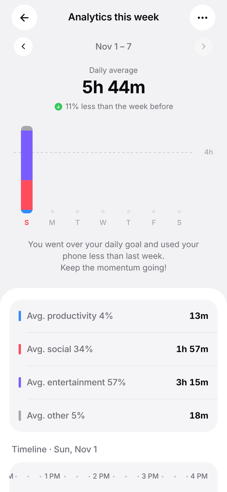
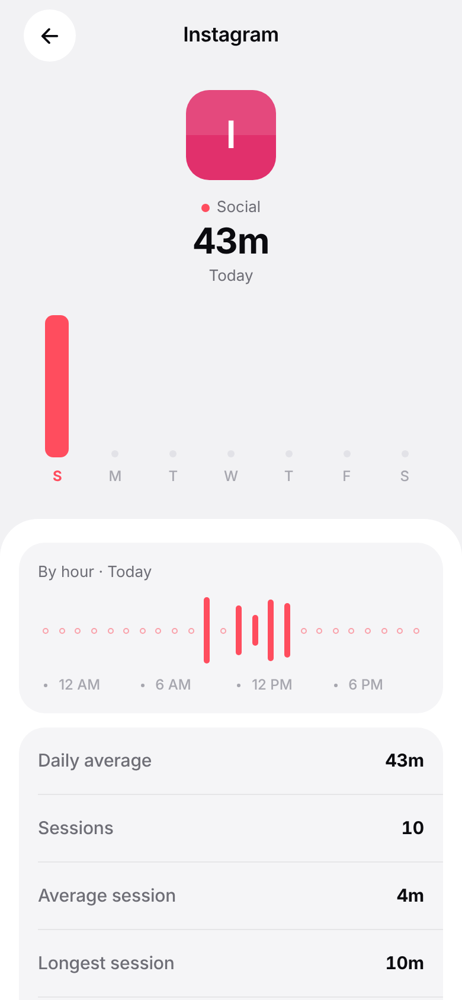
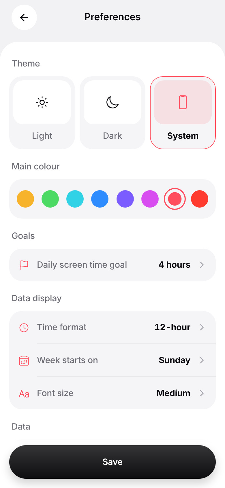

# Screen Time Tracker

A calm, Apple‑style screen‑time tracker built with **React Native + Expo (SDK 58)**. It reads real
per‑app usage on Android, and has room for ADHD‑focused tools later. For now it includes a simple
focus timer.

| Today | Analytics | App detail | Preferences | Dark · Focus |
| --- | --- | --- | --- | --- |
|  |  |  |  |  |

## Features

- **Today**: a dotted dial that fills toward your daily goal and shows the total as `4h 23m`. Above
  it is a strip of week rings (tap a day to view it). Below are a category split, pickups, first
  pickup, longest session, and your most‑used apps.
- **Analytics**: daily average with the change from last week, stacked weekly bars with a goal
  line, category averages, a scrollable session timeline for each day, an hour‑by‑hour chart, and
  your top apps. Use the chevrons to go back through earlier weeks.
- **App detail**: per‑app weekly bars, hourly usage, sessions, average and longest session, and the
  app's share of your total time.
- **Focus session**: pick 15, 25, 45 or 60 minutes, then hold to start and hold to quit. Today's
  focused time and your streak are saved on the device.
- **Preferences**: Light, Dark or System theme; 8 accent colours; daily goal; 12/24‑hour time;
  first day of the week; font size; data source. Changes preview live and apply when you tap
  **Save**.

## Motion & feel

The motion follows Apple's HIG and the animations.dev craft guidelines (`src/theme/motion.ts`):

- **Springs:** they settle with no overshoot. Small elements, like colour swatches, are the only
  ones that bounce.
- **Press feedback:** a quick, subtle scale (about 0.97) plus a haptic tap.
- **Entrances:** each section rises in once, with a stagger. Nothing grows from `scale(0)`.
- **Performance:** only `transform` and `opacity` animate, so data reveals run on the UI thread.
  This covers the rings, the dial sweep, the bars and the progress lines.
- **Hold‑to‑confirm:** the fill moves at a linear pace while you hold, with haptic ticks that build
  up. If you let go early it snaps back quickly.
- **Bottom sheet:** opens on the iOS sheet curve and follows your finger 1:1 as you drag. You can
  fling it away using the drag's speed. The backdrop fade is tied to the sheet's position.
- **Navigation on Android:** uses the iOS‑style slide (`ios_from_right`) with an edge‑swipe back
  gesture.
- **Reduce Motion:** respected everywhere. Movement is removed but fades remain, and the ambient
  "breathing" of the dial is switched off.

## Getting started

```bash
npm install
npx expo start            # Expo Go / web — runs on realistic sample data
```

### Real usage data (Android)

Real tracking uses a local native module, `modules/usage-stats`, built on Android's
`UsageStatsManager`. That module needs a development build, so it won't work in Expo Go:

```bash
npx expo run:android      # or: npx eas-cli build --profile development --platform android
```

On first launch, tap **Allow usage access** and enable the app under *Settings › Usage access*.
The app turns raw foreground events into sessions, so the per‑hour numbers, the timeline and the
session counts are exact. Unlock events are counted as pickups.

### iOS

iOS doesn't let apps read raw screen‑time numbers. Usage is only available through Apple's Screen
Time API (FamilyControls, plus a DeviceActivity report extension), which needs a special Apple
entitlement. Until that's added, iOS uses sample data.

## Project structure

```
src/app/            screens (Expo Router): index, analytics, app/[id], focus, settings
src/components/     UI kit: DottedDial, WeekStrip, WeekBars, HourlyWave, SessionTimeline,
                    OptionSheet, HoldButton, PressableScale, ListRow, …
src/data/           types, aggregation (sessions → day summaries), demo + device sources
src/state/          settings (persisted), usage store/cache, focus sessions
src/theme/          colours, theme hook, motion tokens
modules/usage-stats Android native module (Kotlin, Expo Modules API)
```

## Scripts

```bash
npm run typecheck
npm run lint
```
